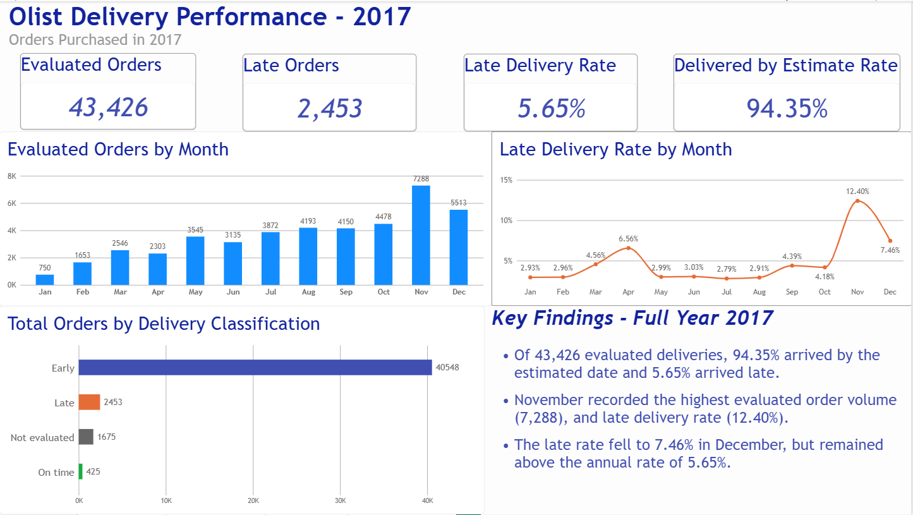
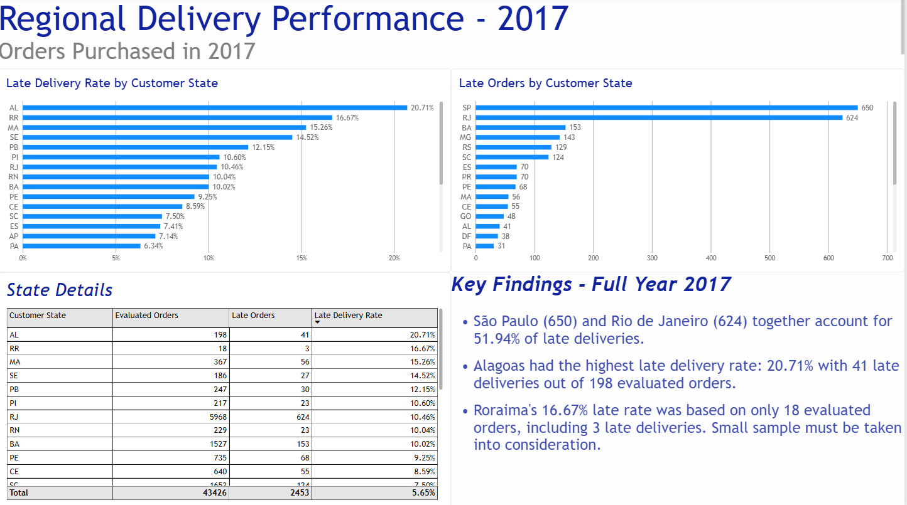
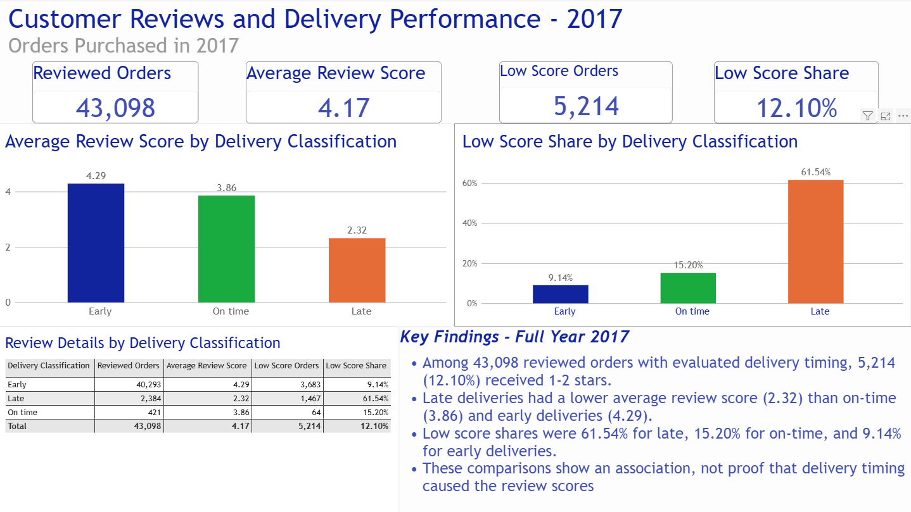

# Olist Delivery Analysis

An independent portfolio project by **Caio Bergamo**, using Excel and Power BI to analyze delivery performance and customer reviews.

## Business objective

Understand whether late deliveries are associated with lower customer review scores, and identify monthly and regional delivery patterns worth investigating.

## Main findings

The analysis covers **orders purchased in 2017**, including those delivered or reviewed in later years.

| Metric | Result |
| --- | ---: |
| Total orders | 45,101 |
| Orders with evaluated delivery timing | 43,426 |
| Evaluated orders with a review | 43,098 |
| Delivered by the estimated date | 94.35% |
| Late-delivery rate | 5.65% |
| Average review score for late deliveries | 2.32 / 5 |

November had the highest evaluated order volume (7,288) and late-delivery rate (12.40%). São Paulo and Rio de Janeiro together accounted for 51.94% of late deliveries. Among reviewed late deliveries, 61.54% received 1–2 stars. These results support investigating delivery capacity and regional delays, while accounting for order volumes and sample sizes.

## Explore the project

| File | Contents |
| --- | --- |
| [Analysis report](REPORT.md) | Findings, recommendations, methodology, and limitations |
| [Report PDF](Olist-Delivery-Analysis.pdf) | Downloadable project write-up |
| [Complete project package](https://github.com/caiocbergamo/Olist_Delivery_Analysis/releases/download/v1.0/Olist-Delivery-Analysis-Project.zip) | Excel workbook, Power BI file, Word report, PDF, and dashboard previews |
| [Source documentation](DATA_SOURCE.md) | Original dataset, preparation, and attribution |

Dashboard previews

### Delivery Overview

### Regional Performance

### Customer Reviews

## Tools and approach

- **Excel:** clean data, check identifiers and joins, calculate delivery classifications, and summarize findings with PivotTables.
- **Power Query:** import and prepare the Orders and Customers tables.
- **Power BI and DAX:** model relationships, calculate measures, and build four interactive report pages.

## Scope and methodology

Orders are grouped by purchase year. Delivery timing uses calendar dates and requires delivered status plus actual and estimated delivery dates. Orders without sufficient delivery information remain in the total cohort but are excluded from delivery-performance rates.

One review is retained per order using the latest review-answer timestamp. Missing scores are excluded from review calculations. Low scores mean 1–2 stars.

## Limitations and interpretation

Results describe historical Olist purchases from 2017 and do not establish that delivery timing caused review scores. Small state samples require caution: Roraima's 16.67% late rate represents 3 of 18 evaluated orders. Product category, seller, distance, and carrier may help explain differences but are not controlled for here.

## Open and refresh

1. Download and extract the **complete project package** linked above. GitHub's automatic source-code ZIP contains repository documentation and previews, rather than the full workbook and PBIX.
2. Open `powerbi/Olist-Delivery-Analysis.pbix` in Power BI Desktop on Windows, or use `excel/Olist Analysis.xlsx` for the prepared data and Excel analysis.
3. To refresh, go to **Transform data → Data source settings → Change Source** and select your local `excel/Olist Analysis.xlsx`. Both Orders and Customers use this workbook. Apply the changes and refresh.

The report pages are Delivery Overview, Regional Performance, Customer Reviews, and Sources and Methodology. Interactive selections affect the relevant visuals; findings labeled **Full Year 2017** remain fixed.

## Data source and attribution

Source: [Olist Brazilian E-Commerce Public Dataset](https://www.kaggle.com/datasets/olistbr/brazilian-ecommerce), provided by Olist under **CC BY-NC-SA 4.0**. Prepared data and analytical adaptations are shared under the same license. See [source details](DATA_SOURCE.md) and [license information](LICENSE.md).

## Other portfolio projects

- [Maven Manufacturing Analysis](https://github.com/caiocbergamo/Maven_Manufacturing_Analysis)
- [Brick Manufacturing Analysis](https://github.com/caiocbergamo/Brick-Manufacturing-Analysis)
